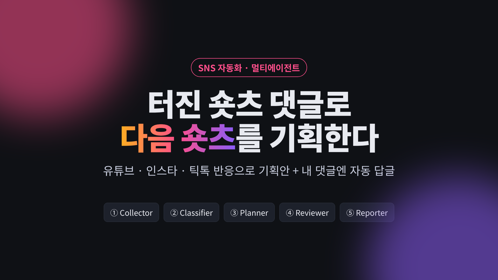

# SNS Shorts Agents

게임 숏츠 크리에이터를 위한 SNS 멀티에이전트입니다. 모드는 두 개입니다.

1. 기획 모드: 유튜브·인스타·틱톡에서 잘 된 게임 숏츠의 댓글 반응을 모아 내 숏츠 기획안을 만듭니다.
2. 답글 모드: 내 계정 숏츠에 달린 댓글을 분류하고, 답글을 써서 검수한 뒤 플랫폼별로 게시합니다.

[](media/demo.mp4)

썸네일을 누르면 시연 영상(`media/demo.mp4`, 90초)이 열립니다.

## Ⅰ. 기획 모드

### 1. 흐름

```
                    Orchestrator (작업 분배, 결과 취합)
① Collector ──▶ ② Classifier ──▶ ③ Planner ⇄ ④ Reviewer ──▶ ⑤ Reporter
  인기 숏츠 댓글     반응 분류        기획 아이디어    검수            기획안 저장
                 (댓글별 병렬)                        └──▶ 사람 확인
```

| 에이전트 | 하는 일 | 지시사항 파일 |
|---|---|---|
| ① Collector | 플랫폼별로 인기 숏츠와 댓글을 모으고, 3자 미만 댓글은 뺀다 | `skills/collector/SKILL.md` |
| ② Classifier | 댓글을 터진 장면, 게임 관심, 요청, 불만, 단순 반응, 스팸으로 나눈다 | `skills/classifier/SKILL.md` |
| ③ Planner | 같은 게임, 같은 반응을 묶어 제목과 첫 3초 훅을 쓴다 | `skills/planner/SKILL.md` |
| ④ Reviewer | 베끼기, 근거 부족, 긴 제목, 내가 못 찍는 게임을 걸러낸다 | `skills/reviewer/SKILL.md` |
| ⑤ Reporter | 아이디어를 근거 댓글 좋아요 순으로 기획안 md에 정리한다 | `skills/reporter/SKILL.md` |

Reviewer가 `revise`를 주면 Planner가 제목을 고쳐 다시 보내고, 최대 2번까지 주고받습니다.

### 2. 샘플 실행 결과

샘플은 시연용으로 지어낸 영상 5개와 댓글 24개입니다. 아이디어 6개가 나왔고, 그중 5개가 승인되고 1개는 사람 확인으로 넘어갔습니다. 제목 수정 요청은 5번 있었습니다. 결과는 [`plans/shorts_plan.md`](plans/shorts_plan.md)에 있습니다.

## Ⅱ. 답글 모드

### 1. 흐름

```
① 수집 ──▶ ② Reply Classifier ──▶ ③ Responder ⇄ ④ Moderator ──▶ ⑤ Publisher
 내 숏츠 새 댓글   질문·칭찬·불만·협업·스팸    답글 초안        검수           플랫폼별 게시
                  (댓글별 병렬)                          └──▶ 사람 확인
```

| 에이전트 | 하는 일 | 지시사항 파일 |
|---|---|---|
| ② Reply Classifier | 질문, 칭찬, 불만, 협업, 스팸, 기타로 나누고 우선순위를 붙인다 | `skills/reply_classifier/SKILL.md` |
| ③ Responder | 플랫폼에 맞게 답글을 쓴다. 유튜브는 설명란, 인스타는 캡션, 틱톡은 고정 댓글로 안내한다 | `skills/responder/SKILL.md` |
| ④ Moderator | 길면 줄이라고 돌려보내고, 협업 제안과 민감한 불만은 사람에게 넘긴다 | `skills/moderator/SKILL.md` |
| ⑤ Publisher | 승인된 답글을 게시하고, 스팸은 지우지 않고 숨긴다 | `skills/publisher/SKILL.md` |

### 2. 플랫폼별 게시 방법

| 플랫폼 | 댓글 읽기 | 답글 달기, 스팸 숨기기 |
|---|---|---|
| 유튜브 | API 키 (`YOUTUBE_API_KEY`, `YOUTUBE_CHANNEL_ID`) | 채널 주인 OAuth 토큰 (`YOUTUBE_OAUTH_TOKEN`). 스팸은 "검토 대기"로 돌림 |
| 인스타그램 | Graph API (`IG_ACCESS_TOKEN`, `IG_USER_ID`) | Graph API로 답글과 숨김 |
| 틱톡 | CSV로 넣기 | 공개 API가 없어서 `plans/tiktok_replies.csv`에 저장. 앱에서 직접 붙여넣기 |

`--post`를 붙이지 않으면 유튜브와 인스타에도 실제로 올리지 않습니다(dry-run).

### 3. 샘플 실행 결과

내 숏츠 3개(유튜브, 인스타, 틱톡)에 달린 가상 댓글 8개로 돌렸습니다. 답글 5개, 스팸 숨김 2개, 사람 확인 1개(협업 제안)가 나왔고, 답글이 길어서 수정 요청이 1번 있었습니다.

## Ⅲ. Skills

에이전트마다 지시사항이 `skills/*/SKILL.md`에 있습니다. 기획 모드 5개, 답글 모드 4개입니다. 처음에 정리한 아이디어 메모는 [`docs/ideation.md`](docs/ideation.md)에 있습니다.

1. SKILL.md를 채우고 `ANTHROPIC_API_KEY`를 넣으면, 그 내용이 에이전트의 지시사항이 되어 Claude가 판단합니다.
2. SKILL.md가 비어 있거나 키가 없으면, 코드에 있는 규칙으로 동작합니다(데모 모드).

## Ⅳ. 실행 방법

```bash
pip install -r requirements.txt
cp .env.example .env

# 기획 모드
python main.py plan                                        # 샘플 데이터
python main.py plan --source youtube --games "Grow a Garden" "99 Nights in the Forest" --days 7
python main.py plan --source csv --csv data/my_comments.csv  # 남의 릴스, 틱톡

# 답글 모드
python main.py reply                                       # 샘플 데이터, dry-run
python main.py reply --source youtube                      # 내 유튜브 채널 댓글
python main.py reply --source instagram --post             # 승인된 답글을 실제로 게시
python main.py reply --source csv --csv tiktok.csv         # 틱톡, 답글은 CSV로 저장

open web/index.html    # 기획 모드 뷰어
open web/reply.html    # 답글 모드 뷰어
```

`.env`의 `MY_GAMES`에 내가 직접 플레이하고 녹화할 수 있는 게임을 적어 두면, 그 밖의 게임 아이디어는 사람 확인으로 넘어갑니다.

## Ⅴ. 시연 영상 제작

12주차 튜토리얼 방식으로 만들었습니다. `video/edit.json`에 샷 순서, 해상도(1920×1080), 24fps, H.264, 자막, BGM 계획을 먼저 적었습니다. 그다음 `video/render.sh`로 ffmpeg 렌더를 하고 ffprobe로 길이와 해상도를 확인했습니다. 썸네일은 영상 첫 장면과 mp4 커버 이미지로 들어갑니다.

## Ⅵ. 폴더 구조

```
agents/          기획 모드 오케스트레이터와 에이전트 5개
agents/reply/    답글 모드 오케스트레이터와 에이전트 4개
skills/          에이전트별 SKILL.md 9개
sources/         유튜브, 인스타그램, 틱톡, CSV 수집과 게시
data/            샘플 데이터, CSV 양식
plans/           기획안, 틱톡 답글 목록
web/             두 모드의 에이전트 협업 뷰어
media/           demo.mp4, thumbnail.png
video/           edit.json, subs.srt, render.sh, 장면 생성 스크립트
docs/            아이디어 메모
```
